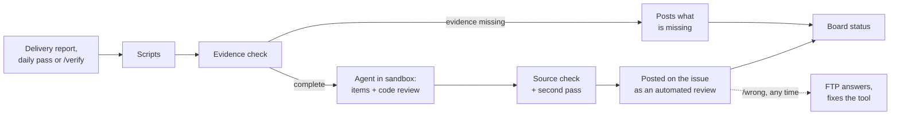

## Development Fund Proposal: Dev Fund Reviewer, Milestone Review Assistant

| Field | Value |
| --- | --- |
| Organization | FTP |
| Author / Primary Contact | Daniel, FTP ([@Denend](https://github.com/Denend)) |
| Status | Submitted |
| Created | 2026-10-19 |
| Proposal Type | RFP-aligned |
| RFP / Roadmap Area | Governance, Identity & Network Coordination, RFP 9 Governance automation |
| Champion | Shaul Kfir, Digital Asset ([@shaul-da](https://github.com/shaul-da)) |
| Total Funding Request | 830,000 CC |
| Project Duration | 4 months build, adoption until month 12 |
| Label | onchain-governance |

---

## Abstract

This proposal adds an AI review assistant to the Dev Fund repository. It does the hands-on part of milestone review for the Fund's reviewers: it installs the packages, builds the code, runs the tests and compares the docs with the code.

The assistant starts when a delivery report is posted. It first checks that the evidence is complete, then gives every deliverable a verdict (Met, Partly met, Not met or Can't verify) with a one-line reason and links to its sources. It also lists rated findings on code quality, architecture and fit with Canton tooling. It posts as an automated reviewer and says it can be wrong, tags the champion when their sign-off is needed and keeps the Fund's milestone board current. The Fund's reviewers still decide.

Every milestone is reviewed before it is paid. From June to September 2026 reviewers received 14 to 23 deliveries a month.

The request is 830,000 CC: 470,000 CC for the build and up to 360,000 CC paid only for live reviews that hold up.

---

## Specification

### 1. Objective

Reviewers get a short, sourced review of each delivery as soon as it is reported and no longer do the installs, builds and test runs by hand. Grantees learn early what evidence is missing.

### 2. Implementation Mechanics

**How a review runs**



1. The assistant starts when the grantee or a listed reviewer posts or edits a delivery report on a milestone issue. A daily pass catches anything missed and skips unchanged reports.
2. Scripts check the basics: links, files, license, CI, package versions, and whether the README's settings match the code.
3. The agent checks the evidence before the deliverables. The report should name the delivered version, give evidence for each item and include what reviewers usually ask for on this kind of milestone, taken from a checklist built from reviewers' comments on past milestones. If the evidence falls short, the assistant posts what is missing and goes no further until the report changes or a listed reviewer runs `/verify`.
4. The agent goes through each item. It reads the milestone, the delivery report and the code, builds and tests the code in a sandbox, opens linked pages and confirms cited transactions on Scan. Then it reviews the code.
5. Code checks every source the agent cites, and a second pass tries to disprove each verdict and finding. A verdict that cannot be confirmed becomes Can't verify, and a finding that cannot be confirmed is dropped.
6. The assistant posts one comment and edits it on later runs. The comment says at the top that an AI agent wrote it, that it may contain mistakes, and that the Fund's reviewers remain responsible for acceptance. When an item likely needs someone's sign-off, it tags the champion or relevant core contributors from the tagging list, at most three people.
7. It sets the milestone's status on the Dev Fund Milestones board, for example Ready for evidence when evidence is missing and Ready for Milestone Review once a full review is posted.

When one milestone has two issues, one from the tracker and one opened by Foundation staff, the assistant reviews it once and links the other issue.

**Commands**

| Command | Who | What it does |
|---|---|---|
| `/verify` | Listed reviewer or the grantee | Runs the review again on the newest version the grantee names, for example after a fix. The grantee gets three runs a day, report edits included. A listed reviewer's run also goes past a failed evidence check. |
| `/wrong D3` | Anyone | Marks posted item D3, or finding C1, as wrong. FTP answers every mark. |

Reviewers are SIG members and Canton Foundation or Digital Asset staff, on a list in the Fund's repository.

**Example result** (made-up delivery):

```
#000 · Milestone 2 · v1.2.0 · Needs fixes
Automated review by an AI agent. It may contain mistakes; the Fund's reviewers remain responsible for acceptance.

Evidence ................ Complete
D1 Ledger client ........ Partly met
   cargo test: 140 passed offline; 12 skip without a node [test log]
D2 Published crate ...... Met
   example-sdk 1.2.0 on crates.io, published before the report [crates.io]
D3 README quick start ... Not met
   README sets API_TOKEN; the code reads EXAMPLE_TOKEN [README.md L40, config.rs L12]
D4 Adoption ............. Can't verify
   Usage is not assessed; the report states "1,200 monthly active users" [report L14]

C1 High ..... Retries with no limit when the participant returns UNAVAILABLE [client.rs L210]
C2 Medium ... Reads balances from Amulet contracts, not the token standard Holding interface [wallet.rs L88]

cc @champion on D1: 12 tests need a node, so the offline result needs your sign-off
```

The top line takes the first status that applies:

- **Evidence missing:** the evidence check failed and the items were not reviewed.
- **Incomplete:** an item is missing or could not be read.
- **Needs fixes:** any item is Not met.
- **Not fully verified:** any item is Partly met or Can't verify.
- **All items met:** every item is Met.

**Checks by delivery type**

- **Code and SDKs:** build and test the delivered version, compare docs with code, check the published package.
- **Services:** match the running version to the code and call the linked endpoints.
- **Integrations:** check the partner's public release.
- **Documents:** check each acceptance item.
- **Audits:** check that the audited version is the delivered one.
- **Node and UI steps:** run on a LocalNet with test parties. A Playwright browser opens each linked web UI, goes through the steps the delivery describes (log in, fill forms, submit) and keeps screenshots.
- **Usage and affiliation:** not assessed. The agent quotes the report line that states them.

**Code review**

- The agent looks at code quality, architecture and how the work fits existing Canton tooling, such as the official SDKs, the token standard, Ledger API versions and Daml package upgrades.
- A review has at most five findings, each rated Critical, High, Medium or Low and pointing to file lines in the delivered version. Findings do not change any verdict or the top line.

**Checks on the agent**

- Every fact behind a verdict or finding has a location: file lines, a registry entry, a test-log line, a Scan record or a script result.
- Code opens each location itself and drops any fact it cannot confirm.
- Met needs at least one fact the tool read or ran itself. The grantee's report or pages alone are not enough.
- Verdict reasons do not grade quality, findings speak only about the lines they cite, and neither recommends a vote.

**Canton notes.** The tool's repository holds sourced notes on Canton, Daml, the Global Synchronizer, official SDKs, Scan and the Fund's process, plus a playbook built from 35 closed milestone issues and the evidence checklist. The agent searches them when it needs them. They are public, so reviewers can see what the agent knows.

**Deployment and security**

- One workflow file in the Fund's repository. Tool and model versions are pinned. The reviewer list, the tagging list and the criteria live in the Fund's repository. A repository switch turns the agent off.
- The model is reached through GitHub's short-lived login token; no API key is stored. No job holds both model access and write access to the issue or the board. A separate job without model access re-checks every cited source, then posts. It removes any link other than a confirmed source or the milestone's other issue, and any @mention of anyone but the champion and people on the tagging list.
- Board statuses go through a GitHub App the Foundation owns. Its key is a secret in the Fund's repository, held only by the job without model access, and the App changes only the Status field on the Dev Fund Milestones board. The assistant never moves a milestone in Ready for Vote or a later column.
- Grantee code runs only in the sandbox: no secrets, no root, no network after install. A failure caused only by missing network, node or credentials gives Can't verify.
- The agent cannot write files or run commands outside the sandbox. It reads the code, GitHub, the npm, crates.io and PyPI registries, public linked pages and a Scan endpoint the Foundation provides.
- Each run's evidence is kept for 90 days. A re-check command confirms every cited source again without the model, so anyone can audit a verdict.

**Known limits.** The report, code and test logs come from the grantee, who is paid on acceptance, and may contain text written to steer the agent. The checks limit what the agent can cite, not what it concludes. Because the assistant posts on its own, a wrong verdict or finding can be public before anyone checks it. Anyone can mark it with `/wrong`, and acceptance stays with the reviewers and the committee.

**Cost.** An agent run reads code, logs and pages over many steps. We estimate US$20 to 50 a full run on a frontier model at October 2026 prices, a few dollars when the evidence check stops a run early, and about US$700 to 3,500 a month at 20 to 35 deliveries with reruns. Each run has a spending cap; items not reached get Can't verify. Builds run on free GitHub runners. FTP pays model usage during the grant and maintenance. Reruns cost the Fund nothing: payment counts each issue once.

**Out of scope:** predicting votes, accepting or rejecting milestones, assessing usage or affiliation, running on proposal pull requests, moving milestones into Ready for Vote or later.

### 3. Architectural Alignment

RFP 9 asks for tools that "reduce manual governance overhead" and lists "automation of repeatable governance workflows" ([Dev Fund roadmap](https://github.com/canton-foundation/canton-dev-fund/blob/main/2026-2028-strategic-roadmap.md)). Milestone review under CIP-0100 is repeated on every delivery.

### 4. Backward Compatibility

The Fund's repository gets one workflow file, the criteria file, the reviewer list and the tagging list, and the Foundation sets up its own GitHub App for the board. Deleting the workflow file turns the tool off.

---

## Milestones and Deliverables

### Milestone 1: The Assistant in the Fund Repository

- **Estimated Delivery:** Month 4 (committed: month 5)
- **Focus:** The assistant reviewing every delivery in the Fund's repository, measured on milestones the agent has not seen.
- **Deliverables / Value Metrics:**
  - Requirements gathered from committee members in the first weeks and published in the tool's repository. The rest of Milestone 1 is built to them. If they change a deliverable below, FTP proposes the change to the committee first.
  - The workflow with scripts, agent, automatic runs, the daily pass, posting and commands, reviewed by the Security SIG.
  - The evidence check, with its checklist built from past reviewer comments, and tagging of the champion or core contributors.
  - The code review with Critical to Low ratings.
  - Board statuses through the Foundation's GitHub App, and one pass that brings every open milestone before Ready for Vote up to date.
  - Sandboxes for Node, Rust, Python, Go and Daml (`dpm`) that report test counts and skipped tests. On 12 closed issues published in the tool's repository, they match the Foundation reviewer's pass or fail on at least 8 of the 19 offline build, install and test steps the reviewer recorded.
  - A LocalNet with test parties that repeats 6 of the 7 LocalNet steps in the same set, and the Playwright browser checks.
  - The re-check command.
  - A "Delivered versions" table for delivery reports, proposed to the Tech & Ops Committee.
  - The accuracy measurement below, published in the tool's repository.

### Milestone 2: Reviewer Adoption

- **Estimated Delivery:** Months 5 to 12 (committed: month 13)
- **Focus:** Live reviews that the Fund's reviewers can rely on.
- **Deliverables / Value Metrics:**
  - An issue qualifies when the assistant posts a full review, past the evidence check, and its milestone then goes to a committee vote. Paid per 10 qualifying issues, up to 30. Each issue counts once.
  - Fewer than 20% of posted verdicts and findings on them are marked wrong by listed reviewers.
  - A monthly note in the tool's repository with the counts, the `/wrong` marks and the fixes.

---

## Acceptance Criteria

**Milestone 1.**
- **Freeze.** By the middle of month 3, FTP freezes a version and runs it twice on each test issue. Every run is published in the tool's repository, not on the issues.
- **Test issues.** Every milestone delivered in the 30 days after the freeze, plus 10 older deliveries picked at random by a method fixed at grant start, at least 20 in all. The older ones are newer than the model's training data and appear in none of the notes, the evidence checklist or the backtest files. The agent sees no comment posted after the report it reviews. For the measurement it reviews every item even when the evidence check fails.
- **Grading.** A reviewer named by the committee, not FTP staff, records their own verdict first, then grades every verdict of the first run and the evidence check on each issue. A verdict is correct if it matches, or if the grader accepts it after checking its sources. Can't verify is correct only where the tool could not have checked. Code findings are graded correct or wrong and reported separately, with their ratings.
- **Pass.** At least 90% of verdicts and evidence checks correct. The report also states how often the two runs agree.

**Milestone 2.** Each tranche is paid when 10 further qualifying issues have a full review from the assistant followed by a committee vote, and listed reviewers have marked under 20% of the posted verdicts and findings on them wrong. If its reviews do not hold up, Milestone 2 pays nothing.

All measurements and counts leave out issues where FTP is the grantee, a named user or a feedback giver, and runs started by FTP staff.

---

## Funding

**Total Funding Request:** 830,000 CC

### Payment Breakdown by Milestone

- Milestone 1 (The Assistant in the Fund Repository): 470,000 CC upon committee acceptance
- Milestone 2 (Reviewer Adoption): 120,000 CC per 10 qualifying milestone issues, up to 360,000 CC

360,000 CC (43%) is paid only for live reviews that hold up.

### Maintenance After Milestone 2

Maintenance is a separate quarterly grant, subject to committee review, at 250,000 CC a quarter, paid when the committee accepts that quarter's note. It covers:

- model usage;
- criteria updates within 14 days of a change to the Fund's documents;
- keeping the sandbox, registry lookups, Canton notes and the evidence checklist current with Canton and Splice releases and new reviewer comments;
- re-grading on every model change, and a graded quarterly sample;
- an answer to every `/wrong` mark, and a first response to bug reports within a week.

If maintenance is not renewed, the agent is switched off and the script checks keep running. If FTP cannot maintain the tool, or the Fund asks, FTP transfers the repository to `canton-foundation`.

### Volatility Stipulation

The grant is denominated in fixed Canton Coin and will require a re-evaluation at the 9-month mark.

---

## Co-Marketing

Announcements with the Canton Foundation at Milestone 1, a technical post with the measurement results, and a short guide for grantees on running the tool before they post a delivery.

---

## Motivation

No milestone is paid without a review, so the tool serves every funded project and every reviewer. Reviewers spend their time on judgment instead of installs and builds. Grantees can run the same checks before they post, so fewer deliveries come back for fixes.

---

## Rationale

- **Why an agent.** Fixed rules cannot tell whether a document covers an acceptance item or whether the tests that ran are the ones that matter. An agent can, but can be wrong, so code checks every source it cites. The Fund's AI policy holds people accountable for what they post under their own name, so the assistant posts under its own account as an AI agent, decides nothing, and FTP answers for every comment.
- **Neutrality.** FTP is a grantee (#78) and an applicant (#617). The tool does not assess usage or affiliation, FTP's issues and runs are left out of every measurement and count, and the committee names the grader. FTP's own deliveries get the same checks as everyone else's. From Milestone 1 the code, prompts and notes are public.
- **Alternatives.** A general coding agent run by each reviewer puts grantee code on their machines, needs every claim checked by hand and leaves no shared record.

**Neighbours:** the Fund's quality gates (#316, #852) and milestone tracker (#380) stay unchanged, and the Dev Fund Milestones board keeps its columns. The Canton Grants Portal (#104, closed) proposed a platform with scoring and payments; this adds none. #886 (SV governance dApp) and #741 (Anode, permissioned governance system) cover Super Validator governance.

---

## Team

FTP Tech has been building on Canton Network since September 2025.

So far we have delivered one of the most advanced and powerful AI tools on Canton Network:

1. The x402 standard under Proposal [#78](https://github.com/canton-foundation/canton-dev-fund/pull/78), with CIP-56 token support beyond the scope ([link](https://x.com/bscnews/status/2075315750491820513)).
2. AI agents that trade and pay for services on Canton ([link](https://x.com/ftpwhatsoever/status/2094779599116771664)):
   1. Advanced wallet for AI agents:
      - CIP-56 swap support
      - x402 payments
      - Token transfers, pre-approvals, claims, UTXO merges, etc.
   2. Advanced local and remote MCPs for agents:
      - Trading
      - x402 payments
      - Transfers
