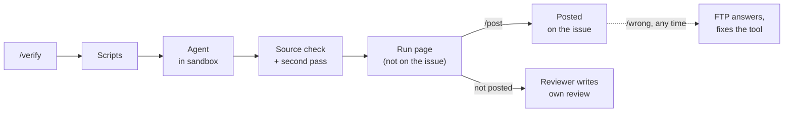

## Development Fund Proposal: Dev Fund Reviewer, Milestone Review Assistant

| Field | Value |
| --- | --- |
| Organization | FTP |
| Author / Primary Contact | Daniel, FTP ([@Denend](https://github.com/Denend)) |
| Status | Submitted |
| Created | 2026-10-19 |
| Proposal Type | RFP-aligned |
| RFP / Roadmap Area | Governance, Identity & Network Coordination, RFP 9 Governance automation |
| Champion | Needs Champion |
| Total Funding Request | 660,000 CC |
| Project Duration | 3 months build, adoption until month 12 |
| Label | onchain-governance |

---

## Abstract

This proposal adds an AI review assistant to the Dev Fund repository. It does the hands-on part of milestone review for the Fund's reviewers: it installs the packages, builds the code, runs the tests and compares the docs with the code.

A reviewer types `/verify` on a milestone issue. The assistant returns a verdict for every deliverable (Met, Partly met, Not met or Can't verify), each with a one-line reason and links to its sources. The reviewer decides what to post. Nothing appears on the issue without them.

Every milestone is reviewed before it is paid. From June to September 2026 reviewers received 14 to 23 deliveries a month.

The request is 660,000 CC: 300,000 CC for the build and up to 360,000 CC paid only when reviewers use the tool.

---

## Specification

### 1. Objective

Reviewers get a short, sourced verdict on each item of a delivery and no longer do the installs, builds and test runs by hand.

### 2. Implementation Mechanics

**How a review runs**



1. A reviewer types `/verify` on the milestone issue. Reviewers are SIG members and Canton Foundation or Digital Asset staff, on a list in the Fund's repository.
2. Scripts check the basics: links, files, license, CI, package versions, and whether the README's settings match the code.
3. The agent goes through each item. It reads the milestone, the delivery report and the code, builds and tests the code in a sandbox, opens linked pages and confirms cited transactions on Scan.
4. Code checks every source the agent cites, and a second pass tries to disprove each verdict. A verdict that cannot be confirmed becomes Can't verify.
5. The result appears on the workflow run's page, not on the issue. Like all Actions logs in a public repository, that page is public. The reviewer reads it and decides what to post.

**Commands**

| Command | Who | What it does |
|---|---|---|
| `/verify` | Listed reviewer | Runs the review. Run it again after the grantee pushes a fix; it checks the newest version the grantee names. Posts nothing. |
| `/post` | Listed reviewer | Posts the whole result to the issue, with the model and the reviewer's name. |
| `/post D1 D3` | Listed reviewer | Posts only items D1 and D3. Items are numbered D1, D2… in the result. |
| `/wrong D3` | Anyone | Marks posted item D3 as wrong. FTP answers every mark. |

**Example result** (made-up delivery):

```
#000 · Milestone 2 · v1.2.0 · Needs fixes
D1 Ledger client ........ Partly met
   cargo test: 140 passed offline; 12 skip without a node [test log]
D2 Published crate ...... Met
   example-sdk 1.2.0 on crates.io, published before the report [crates.io]
D3 README quick start ... Not met
   README sets API_TOKEN; the code reads EXAMPLE_TOKEN [README.md L40, config.rs L12]
D4 Adoption ............. Can't verify
   Usage is not assessed; the report states "1,200 monthly active users" [report L14]
```

The top line takes the first status that applies:

- **Incomplete:** an item is missing or could not be read.
- **Needs fixes:** any item is Not met.
- **Not fully verified:** any item is Partly met or Can't verify.
- **All items met:** every item is Met.

**Checks by delivery type**

- **Code and SDKs:** build and test the delivered version, compare docs with code, check the published package.
- **Services:** match the running version to the code and call the linked endpoints.
- **Integrations:** check the partner's public release.
- **Documents:** check each acceptance item.
- **Audits:** check that the audited version is the delivered one.
- **Node and UI steps:** run on a LocalNet with test parties. A Playwright browser opens each linked web UI, goes through the steps the delivery describes (log in, fill forms, submit) and keeps screenshots.
- **Usage and affiliation:** not assessed. The agent quotes the report line that states them.

**Checks on the agent**

- Every fact behind a verdict has a location: file lines, a registry entry, a test-log line, a Scan record or a script result.
- Code opens each location itself and drops any fact it cannot confirm.
- Met needs at least one fact the tool read or ran itself. The grantee's report or pages alone are not enough.
- Reasons do not grade quality or recommend a vote.

**Canton notes.** The tool's repository holds sourced notes on Canton, Daml, the Global Synchronizer, official SDKs, Scan and the Fund's process, plus a playbook built from 35 closed milestone issues. The agent searches them when it needs them. They are public, so reviewers can see what the agent knows.

**Deployment and security**

- One workflow file in the Fund's repository. Tool and model versions are pinned. The reviewer list and criteria live in the Fund's repository. A repository switch turns the agent off.
- The model is reached through GitHub's short-lived login token; no API key is stored. No job holds both model access and write access to the issue.
- Grantee code runs only in the sandbox: no secrets, no root, no network after install. A failure caused only by missing network, node or credentials gives Can't verify.
- The agent cannot write files or run commands outside the sandbox. It reads the code, GitHub, the npm, crates.io and PyPI registries, public linked pages and a Scan endpoint the Foundation provides.
- Each run's evidence is kept for 90 days. A re-check command confirms every cited source again without the model, so anyone can audit a verdict.

**Known limits.** The report, code and test logs come from the grantee, who is paid on acceptance, and may contain text written to steer the agent. The checks limit what the agent can cite, not what it concludes. The reviewer and `/wrong` are the safeguard.

**Cost.** An agent run reads code, logs and pages over many steps. We estimate US$15 to 40 a run on a frontier model at October 2026 prices, about US$600 to 2,800 a month at 20 to 35 deliveries with reruns. Each run has a spending cap; items not reached get Can't verify. Builds run on free GitHub runners. FTP pays model usage during the grant and maintenance. Reruns cost the Fund nothing: payment counts each issue once.

**Out of scope:** predicting votes, assessing usage or affiliation, running on proposal pull requests, posting without a reviewer.

### 3. Architectural Alignment

RFP 9 asks for tools that "reduce manual governance overhead" and lists "automation of repeatable governance workflows" ([Dev Fund roadmap](https://github.com/canton-foundation/canton-dev-fund/blob/main/2026-2028-strategic-roadmap.md)). Milestone review under CIP-0100 is repeated on every delivery.

### 4. Backward Compatibility

The Fund's repository gets one workflow file, the criteria file and the reviewer list. Deleting the workflow file turns the tool off.

---

## Milestones and Deliverables

### Milestone 1: The Assistant in the Fund Repository

- **Estimated Delivery:** Month 3 (committed: month 4)
- **Focus:** `/verify` and `/post` live in the Fund's repository, measured on milestones the agent has not seen.
- **Deliverables / Value Metrics:**
  - The workflow with scripts, agent and commands, reviewed by the Security SIG.
  - Sandboxes for Node, Rust, Python, Go and Daml (`dpm`) that report test counts and skipped tests. On 12 closed issues published in the tool's repository, they match the Foundation reviewer's pass or fail on at least 8 of the 19 offline build, install and test steps the reviewer recorded.
  - A LocalNet with test parties that repeats 6 of the 7 LocalNet steps in the same set, and the Playwright browser checks.
  - The re-check command.
  - A "Delivered versions" table for delivery reports, proposed to the Tech & Ops Committee.
  - The accuracy measurement below, published in the tool's repository.

### Milestone 2: Reviewer Adoption

- **Estimated Delivery:** Months 4 to 12 (committed: month 13)
- **Focus:** Use by the Fund's reviewers.
- **Deliverables / Value Metrics:**
  - Reviewers run `/verify` on milestone issues that have a delivery report, paid per 10 issues, up to 30. Each issue counts once.
  - Fewer than 20% of posted items are marked wrong by reviewers.
  - A monthly note in the tool's repository with the counts, the `/wrong` marks and the fixes.

---

## Acceptance Criteria

**Milestone 1.**
- **Freeze.** By the middle of month 2, FTP freezes a version and runs it twice on each test issue. Every run is published.
- **Test issues.** Every milestone delivered in the 30 days after the freeze, plus 10 older deliveries picked at random by a method fixed at grant start, at least 20 in all. The older ones are newer than the model's training data and appear in none of the notes or backtest files. The agent sees no comment posted after the report it reviews.
- **Grading.** A reviewer named by the committee, not FTP staff, records their own verdict first, then grades every verdict of the first run. A verdict is correct if it matches, or if the grader accepts it after checking its sources. Can't verify is correct only where the tool could not have checked.
- **Pass.** At least 90% correct. The report also states how often the two runs agree.

**Milestone 2.** Each tranche is paid when reviewers have run `/verify` on 10 further qualifying issues and under 20% of posted items on them are marked wrong. If reviewers do not use the tool, Milestone 2 pays nothing.

All measurements and counts leave out issues where FTP is the grantee, a named user or a feedback giver, and runs started by FTP staff.

---

## Funding

**Total Funding Request:** 660,000 CC

### Payment Breakdown by Milestone

- Milestone 1 (The Assistant in the Fund Repository): 300,000 CC upon committee acceptance
- Milestone 2 (Reviewer Adoption): 120,000 CC per 10 qualifying milestone issues, up to 360,000 CC

360,000 CC (55%) depends on reviewers using the tool.

### Maintenance After Milestone 2

Maintenance is a separate quarterly grant, subject to committee review, at 250,000 CC a quarter, paid when the committee accepts that quarter's note. It covers:

- model usage;
- criteria updates within 14 days of a change to the Fund's documents;
- keeping the sandbox, registry lookups and Canton notes current with Canton and Splice releases;
- re-grading on every model change, and a graded quarterly sample;
- an answer to every `/wrong` mark, and a first response to bug reports within a week.

If maintenance is not renewed, the agent is switched off and the script checks keep running. If FTP cannot maintain the tool, or the Fund asks, FTP transfers the repository to `canton-foundation`.

### Volatility Stipulation

The grant is denominated in fixed Canton Coin and will require a re-evaluation at the 9-month mark.

---

## Co-Marketing

Announcements with the Canton Foundation at Milestone 1, a technical post with the measurement results, and a short guide for grantees on running the tool before they post a delivery.

---

## Motivation

No milestone is paid without a review, so the tool serves every funded project and every reviewer. Reviewers spend their time on judgment instead of installs and builds. Grantees can run the same checks before they post, so fewer deliveries come back for fixes.

---

## Rationale

- **Why an agent.** Fixed rules cannot tell whether a document covers an acceptance item or whether the tests that ran are the ones that matter. An agent can, but can be wrong, so code checks every source it cites and a named reviewer posts the result, as the Fund's AI policy requires.
- **Neutrality.** FTP is a grantee (#78) and an applicant (#617). The tool does not assess usage or affiliation, FTP's issues and runs are left out of every measurement and count, and the committee names the grader. FTP's own deliveries get the same checks as everyone else's. From Milestone 1 the code, prompts and notes are public.
- **Alternatives.** A general coding agent run by each reviewer puts grantee code on their machines, needs every claim checked by hand and leaves no shared record.

**Neighbours:** the Fund's quality gates (#316, #852) and milestone tracker (#380) stay unchanged. The Canton Grants Portal (#104, closed) proposed a platform with scoring and payments; this adds none. #886 (SV governance dApp) and #741 (Anode, permissioned governance system) cover Super Validator governance.

---

## Team

FTP Tech has been building on Canton Network since September 2025.

So far we have delivered one of the most advanced and powerful AI tools on Canton Network:

1. The x402 standard under Proposal [#78](https://github.com/canton-foundation/canton-dev-fund/pull/78), with CIP-56 token support beyond the scope ([link](https://x.com/bscnews/status/2075315750491820513)).
2. AI agents that trade and pay for services on Canton ([link](https://x.com/ftpwhatsoever/status/2094779599116771664)):
   1. Advanced wallet for AI agents:
      - CIP-56 swap support
      - x402 payments
      - Token transfers, pre-approvals, claims, UTXO merges, etc.
   2. Advanced local and remote MCPs for agents:
      - Trading
      - x402 payments
      - Transfers
